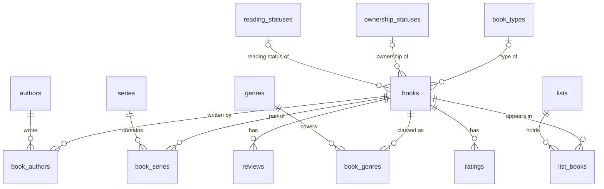

# MyBookTally
Too many books to remember and too few shelves to hold them? MyBookTally makes keeping track of your personal book collection a breeze.

MyBookTally is a desktop app for Linux and Windows, written in C++ with Qt 6. Your library is kept in a single SQLite database file on your own computer.

MyBookTally is a simple, easy-to-use desktop application that helps you keep track of the books you own. Whether you have a handful of favorites or a collection that could rival a small library, MyBookTally lets you catalog your books, browse your collection, and quickly find what you're looking for. No more wondering whether you already own that book or accidentally buying a second copy. With MyBookTally, you'll always know what's on your shelves, even when you can't remember where you put it.

## Contents

- [Features](#features)
- [Where your data is kept](#where-your-data-is-kept)
- [Building](#building)
  - [Building on Linux](#building-on-linux)
  - [Building on Windows](#building-on-windows)
  - [Using an IDE](#using-an-ide)
- [Running the automated tests](#running-the-automated-tests)
- [Versions and releases](#versions-and-releases)
- [The database](#the-database)
  - [Tables](#tables)
  - [How the tables relate](#how-the-tables-relate)
  - [SQL queries](#sql-queries)
- [Import and export file format](#import-and-export-file-format)
- [Project layout](#project-layout)
- [License](#license)

## Features

- **Book list.** Every book in your library in one table. Click a column heading to sort by it, and type in the search box to filter by title, author, series, genre, or any other field.
- **Choose your columns.** Show any of the book's fields, plus the names of its authors, series, and genres, its average rating, and so on. Use **View › Columns**, or right-click a column heading. Title and Authors are shown by default. Your choice is remembered.
- **Book details.** Double-click a book (or press Enter) to see every field, the names of everything it links to, its cover, its reviews and ratings, and the lists it is in.
- **Add, edit, and delete books.** A book records:
  - its title
  - its authors, in credit order
  - the series it belongs to, with its number in each (decimals are allowed, so a book set between 1 and 2 can be 1.5, and you can add a label such as "Prequel")
  - its genres
  - when it was released
  - its ISBN (checked as you type)
  - how many pages it has
  - its type (hardcover, paperback, ...)
  - whether you have it or want it
  - whether you have read it
  - where it is
  - a description
  - a cover image
- **Private books.** Tick "Private" to hide a book from the main library list. **View › Show Private Books** shows them again.
- **Ratings and reviews.** Rate a book on any scale ("4/5", "8/10") and write reviews. Each can be your own or someone else's.
- **Lists.** Make your own lists ("Favorites", "To buy", "Book club"), add books to them and remove books from them, and view each list on its own. Removing a book from a list never deletes the book.
- **Manage menu.** Rename, describe, or delete authors, series, genres, book types, ownership statuses, and reading statuses. Each one shows how many books use it.
- **Import and export.** Save all the books shown, or just the selected ones, to a JSON file. You can export with IDs, which suits backups and moving to another computer: importing the file again updates the same books instead of duplicating them. Or export with names only, which is easier to read or to produce with another program. See [Import and export file format](#import-and-export-file-format).

Planned for later: importing and exporting your book list to and from the MyBookTally website, once it exists, for your account there.

## Where your data is kept

| | Library database | Window and column settings |
| --- | --- | --- |
| Linux | `~/.local/share/MyBookTally/MyBookTally.sqlite` | `~/.config/MyBookTally/MyBookTally.conf` |
| Windows | `%APPDATA%\MyBookTally\MyBookTally.sqlite` | Registry: `HKEY_CURRENT_USER\Software\MyBookTally\MyBookTally` |

**Help › About MyBookTally** shows the exact path on your computer. To back up your library, copy the `.sqlite` file while the app is closed, or use **File › Export**.

To try things out without touching your real library, start the app with a different database file:

```sh
MyBookTally --database /path/to/test-library.sqlite
```

`MyBookTally --help` lists the options. `MyBookTally --version` prints the version.

## Building

The project uses **CMake** with **presets**: named, ready-made build settings kept in [CMakePresets.json](CMakePresets.json). There is one preset for each combination of platform and build type:

| Preset | Platform | Build type | Build folder |
| --- | --- | --- | --- |
| `linux-debug` | Linux | Debug | `build/linux-debug` |
| `linux-release` | Linux | Release | `build/linux-release` |
| `windows-debug` | Windows (Visual C++) | Debug | `build\windows-debug` |
| `windows-release` | Windows (Visual C++) | Release | `build\windows-release` |

**Debug** builds include debugging information and no optimization, so they work well in a debugger. **Release** builds are optimized and are what you would give to other people.

Each preset is also a **workflow preset**: one command that configures, builds, and runs all the tests:

```sh
cmake --workflow --preset linux-release
```

You can also run the three steps on their own, which is quicker when you are rebuilding repeatedly:

```sh
cmake --preset linux-debug           # configure (needed once, or after changing CMakeLists.txt)
cmake --build --preset linux-debug   # build
ctest --preset linux-debug           # run the tests
```

To start again from scratch, delete the build folder (`build/<preset>`).

**Requirements on every platform:**

- CMake 3.25 or newer
- Ninja
- Qt 6.4 or newer, with the Widgets and SQL modules and the SQLite driver
- a C++17 compiler

### Building on Linux

These steps are for Ubuntu 24.04 or Debian 12 and newer. Other distributions have the same packages under different names (on Fedora: `cmake ninja-build gcc-c++ qt6-qtbase-devel`).

1. **Install the build tools and Qt:**

   ```sh
   sudo apt update
   sudo apt install build-essential cmake ninja-build git \
       qt6-base-dev libqt6sql6-sqlite libgl-dev
   ```

   `libqt6sql6-sqlite` is Qt's SQLite driver. Without it the app builds, but it cannot open its database.

2. **Get the source:**

   ```sh
   git clone https://github.com/jeffcrone/MyBookTally.git
   cd MyBookTally
   ```

3. **Build a debug version** (this also runs the tests):

   ```sh
   cmake --workflow --preset linux-debug
   ```

   Run it with:

   ```sh
   ./build/linux-debug/src/app/MyBookTally
   ```

4. **Build a release version** (this also runs the tests):

   ```sh
   cmake --workflow --preset linux-release
   ```

   Run it with:

   ```sh
   ./build/linux-release/src/app/MyBookTally
   ```

5. **Optional: install it** for your own user, with a menu entry and icon:

   ```sh
   cmake --install build/linux-release --prefix ~/.local
   ```

   This copies the program to `~/.local/bin`, the menu entry to `~/.local/share/applications`, and the icons to `~/.local/share/icons/hicolor`. Without `--prefix`, the files go to `dist/linux-release` inside the project folder.

If CMake cannot find Qt (for example, because you installed Qt with the Qt online installer rather than from your distribution), tell it where Qt is:

```sh
cmake --preset linux-debug -DCMAKE_PREFIX_PATH=$HOME/Qt/6.8.3/gcc_64
```

### Building on Windows

These steps use Microsoft Visual C++ (MSVC), the same compiler the GitHub release uses.

1. **Install Visual Studio 2022** (the free Community edition is fine) from <https://visualstudio.microsoft.com/>. In the installer, choose the **Desktop development with C++** workload. This includes the compiler, CMake, and Ninja.

2. **Install Qt** with the Qt Online Installer from <https://www.qt.io/download-qt-installer-oss>. Choose a Qt 6 version (6.8 LTS or newer is recommended). Under it, select **MSVC 2022 64-bit**. This guide assumes the default location, `C:\Qt`. If you put Qt somewhere else, change the paths below to match.

3. **Install Git** from <https://git-scm.com/download/win>, if you do not already have it.

4. **Open the "x64 Native Tools Command Prompt for VS 2022"** from the Start menu. A normal Command Prompt or PowerShell window will not work: this one sets up the paths that let CMake find the compiler.

5. **Get the source:**

   ```bat
   git clone https://github.com/jeffcrone/MyBookTally.git
   cd MyBookTally
   ```

6. **Tell CMake where Qt is**, using your Qt version in the path:

   ```bat
   set CMAKE_PREFIX_PATH=C:\Qt\6.8.3\msvc2022_64
   ```

   This setting lasts until you close the window. To make it permanent, add `CMAKE_PREFIX_PATH` under **Settings › System › About › Advanced system settings › Environment Variables**.

7. **Build a debug version** (this also runs the tests):

   ```bat
   cmake --workflow --preset windows-debug
   ```

8. **Build a release version** (this also runs the tests):

   ```bat
   cmake --workflow --preset windows-release
   ```

9. **Make a runnable copy.** A Windows program looks for the DLLs it needs in its own folder, and a fresh build folder has none of Qt's DLLs. The install step copies the program together with every Qt DLL and plugin it needs (it runs Qt's `windeployqt` for you):

   ```bat
   cmake --install build\windows-release
   dist\windows-release\bin\MyBookTally.exe
   ```

   For the debug version, use `build\windows-debug`. Its copy goes to `dist\windows-debug\bin`.

   To put the copy somewhere else, add `--prefix` with a **full** path, such as `--prefix C:\Apps\MyBookTally`. A relative path such as `--prefix out` fails on Windows with "Given qt.conf path is not an absolute path", because Qt's deployment step requires an absolute one.

   The `dist\windows-release\bin` folder is self-contained. Zip it up and it runs on any 64-bit Windows 10 or 11 PC, which is how the GitHub release is made. On some PCs, Windows may also ask for the Microsoft Visual C++ Redistributable, which you can get from Microsoft.

If you build from inside **Qt Creator** or **Visual Studio** (see [Using an IDE](#using-an-ide)), the IDE adds Qt to the path when it runs the app, so you can run it without the install step.

### Using an IDE

- **Qt Creator** (Linux and Windows): **File › Open File or Project**, then choose `CMakeLists.txt`. Qt Creator reads `CMakePresets.json` and offers the presets as build configurations.
- **Visual Studio 2022** (Windows): **File › Open › Folder** and choose the project folder. Pick a preset from the configuration drop-down. You still need to set `CMAKE_PREFIX_PATH`, either as above or in a `CMakeUserPresets.json`.
- **VS Code**: install the CMake Tools extension and open the folder. It also picks up the presets.

## Running the automated tests

The tests are written with Qt Test and run by CTest. There are 9 test programs, which together check every database query, the import and export code, ISBN checking, the table model, and the main window and dialogs:

| Test | What it covers |
| --- | --- |
| `tst_database` | Opening and creating the database, the schema, foreign keys, refusing a database from a newer version, transactions and rollback |
| `tst_isbn` | ISBN clean-up, shape checks, and check digits for ISBN-10 and ISBN-13 |
| `tst_lookup_repository` | Authors, series, genres, book types, and statuses: add, find, rename, delete, usage counts, unique names |
| `tst_book_repository` | Saving and reading books with every field and link, updates, deletes and what they cascade to, the list query, private books |
| `tst_review_repository` | Reviews and ratings, including rating-range validation |
| `tst_list_repository` | Lists, and adding books to and removing books from them |
| `tst_json_exchange` | Export with and without IDs, import into an empty library, re-importing without duplicates, matching books by ISBN or by title and authors, bad files |
| `tst_book_table_model` | What each column shows, and that numbers sort as numbers |
| `tst_gui` | The main window (columns, search, lists, private books), the book editor, the details dialog, and the manage dialog, driven as a user would |

The tests never touch your real library: each one uses its own throwaway in-memory database and a throwaway settings file. The window tests use Qt's "offscreen" display, so no windows appear and no screen is needed.

**On Linux** (from the project folder):

```sh
cmake --workflow --preset linux-debug   # build and test in one step

# or, after a build:
ctest --preset linux-debug              # all tests
ctest --preset linux-debug -R json      # only tests whose name contains "json"
ctest --preset linux-debug -V           # show every test's full output
```

Use `linux-release` in place of `linux-debug` to test the release build.

**On Windows** (in the "x64 Native Tools Command Prompt for VS 2022", with `CMAKE_PREFIX_PATH` set as in [Building on Windows](#building-on-windows)):

```bat
cmake --workflow --preset windows-debug

rem or, after a build:
ctest --preset windows-debug
ctest --preset windows-debug -R json
ctest --preset windows-debug -V
```

Use `windows-release` in place of `windows-debug` to test the release build. CTest adds Qt's `bin` folder to `PATH` for the tests automatically, so you do not need to install or deploy anything first.

**Running one test program directly** gives Qt Test's own options, such as running a single test function:

```sh
# Linux
QT_QPA_PLATFORM=offscreen ./build/linux-debug/tests/tst_json_exchange -v2
./build/linux-debug/tests/tst_book_repository removeCascades
```

```bat
rem Windows: Qt's DLLs must be on PATH when you run a test program yourself
set PATH=C:\Qt\6.8.3\msvc2022_64\bin;%PATH%
build\windows-debug\tests\tst_json_exchange.exe -v2
```

Add `-help` to any test program to see all of its options.

The tests also run on GitHub: on every push to `main`, on every pull request, and before every release (see below).

## Versions and releases

The version number is written in exactly one place: the `project()` call at the top of [CMakeLists.txt](CMakeLists.txt).

```cmake
project(MyBookTally
	VERSION 0.0.1
	...
```

Everything else takes the version from there: `MyBookTally --version`, the About box, the version shown in the Windows file properties, the `appVersion` in exported files, and the release workflow.

**To make a release, raise the version in `CMakeLists.txt` and push the change to `main`.** The [release workflow](.github/workflows/release.yml) then:

1. reads the version from `CMakeLists.txt`, and stops (successfully, doing nothing) if a GitHub release for that version already exists;
2. builds and runs all the tests on Linux and on Windows, and stops if any test fails;
3. builds the Windows release version and packages it with everything it needs to run, as `MyBookTally-<version>-windows-x64.zip`;
4. creates the tag `v<version>` and a GitHub release with the zip attached and release notes generated from the commits.

Pushes that do not change the version do not make a release. You can also start the workflow by hand from the repository's **Actions** tab (choose **Release**, then **Run workflow**). It applies the same rule, so this is how to retry a release that failed part-way. Re-running is safe: if the release already exists, the zip on it is replaced.

The workflow only ever creates tags. It never runs because a tag was pushed.

The [tests workflow](.github/workflows/tests.yml) builds the debug versions and runs all the tests on Linux and on Windows:

- on every push to `main`;
- on every pull request into `main`, when it is opened and on every later push to it.

On a pull request, it posts a comment saying whether the tests passed on each platform. Later runs update that same comment instead of adding new ones. A pull request from a **fork** gets a read-only token from GitHub, so the comment cannot be posted there; the result appears in the workflow run's summary instead.

## The database

The library is one SQLite file. Every table's `id` is a GUID stored as text (for example `3f2b8c1e-5a7d-4e0b-9c1a-2d4e6f8a0b1c`), not an auto-increment number. That way a book keeps its identity when it is exported from one library and imported into another (or, later, synced with the website), and it can never collide with a book that is already there.

The schema is created by [src/core/Schema.cpp](src/core/Schema.cpp). Its version is kept in SQLite's built-in `user_version` setting. When a later version of MyBookTally changes the tables, it upgrades older library files automatically when it opens them. It refuses to open a file written by a newer version than itself, rather than risk damaging it.

Times are stored as ISO 8601 text in UTC (for example `2026-11-10T14:03:27.512Z`), which sorts correctly as plain text. Optional values that are not set are stored as `NULL`.

### Tables

There are 14 tables:

- **Main records:** `books`, `authors`, `series`, `genres`, `lists`
- **Drop-down choices:** `book_types`, `ownership_statuses`, `reading_statuses`
- **Things attached to a book:** `reviews`, `ratings`
- **Junction tables that link books to other records:** `book_authors`, `book_series`, `book_genres`, `list_books`

#### `books`

One row per book.

| Column | Type | Required | Description |
| --- | --- | --- | --- |
| `id` | TEXT | yes | GUID. Primary key. |
| `title` | TEXT | yes | The book's title. Must not be blank. |
| `release_date` | TEXT | no | `YYYY`, `YYYY-MM`, or `YYYY-MM-DD`, since often only the year is known. |
| `isbn` | TEXT | no | ISBN-10 or ISBN-13, stored without hyphens or spaces (`9780306406157`), so the same book typed two ways still matches. |
| `page_count` | INTEGER | no | Number of pages. Must be more than 0 when set. |
| `book_type_id` | TEXT | no | The book's type (hardcover, paperback, ...). → `book_types.id`. Set to NULL if that type is deleted. |
| `ownership_status_id` | TEXT | no | Whether you have it, want it, and so on. → `ownership_statuses.id`. Set to NULL if that status is deleted. |
| `reading_status_id` | TEXT | no | Whether you have read it, are reading it, and so on. → `reading_statuses.id`. Set to NULL if that status is deleted. |
| `location` | TEXT | no | Where the book is ("Living room shelf"), or for a book you want, where to get it ("Downtown bookstore"). |
| `description` | TEXT | no | Free text about the book. |
| `cover_image` | BLOB | no | The cover image file (JPEG, or PNG if it has transparency). Images are scaled down to fit 600×900 pixels when chosen, to keep the database small. |
| `is_private` | INTEGER | yes | `1` hides the book from the main library list; `0` (the default) shows it. Private books still appear in lists you add them to. |
| `created_at` | TEXT | yes | When the book was added (UTC). |
| `updated_at` | TEXT | yes | When the book was last changed (UTC). |

#### `authors`

| Column | Type | Required | Description |
| --- | --- | --- | --- |
| `id` | TEXT | yes | GUID. Primary key. |
| `name` | TEXT | yes | The author's name. Must not be blank. Names are **not** unique, because two different authors can share a name. |
| `bio` | TEXT | no | A short biography. |
| `birth_date` | TEXT | no | `YYYY-MM-DD`, or just `YYYY`. |

#### `series`

| Column | Type | Required | Description |
| --- | --- | --- | --- |
| `id` | TEXT | yes | GUID. Primary key. |
| `name` | TEXT | yes | The series name. Unique, ignoring case. |
| `description` | TEXT | no | Free text about the series. |

#### `genres`

| Column | Type | Required | Description |
| --- | --- | --- | --- |
| `id` | TEXT | yes | GUID. Primary key. |
| `name` | TEXT | yes | The genre name. Unique, ignoring case. |
| `description` | TEXT | no | Free text about the genre. |

#### `book_types`, `ownership_statuses`, `reading_statuses`

Three tables with the same layout. They hold the choices offered in the book editor's Type, Ownership, and Reading status drop-downs.

| Column | Type | Required | Description |
| --- | --- | --- | --- |
| `id` | TEXT | yes | GUID. Primary key. |
| `name` | TEXT | yes | The choice's name. Unique within its table, ignoring case. |

A new library starts with these choices. You can rename, add to, or delete any of them from the **Manage** menu:

| Table | Starting rows |
| --- | --- |
| `book_types` | Hardcover, Paperback, Mass Market Paperback, E-book, Audiobook |
| `ownership_statuses` | Have, Want, Borrowed, Lent Out |
| `reading_statuses` | To Read, Reading, Read, Did Not Finish |

#### `reviews`

A written review of a book. A book can have any number.

| Column | Type | Required | Description |
| --- | --- | --- | --- |
| `id` | TEXT | yes | GUID. Primary key. |
| `book_id` | TEXT | yes | The book reviewed. → `books.id`. The review is deleted with the book. |
| `review_text` | TEXT | yes | The review. Must not be blank. |
| `reviewer` | TEXT | no | Who wrote it. Empty means you. |
| `created_at` | TEXT | yes | When it was added (UTC). |

#### `ratings`

A score for a book. A book can have any number. They are kept separate from reviews because people often rate a book without reviewing it.

| Column | Type | Required | Description |
| --- | --- | --- | --- |
| `id` | TEXT | yes | GUID. Primary key. |
| `book_id` | TEXT | yes | The book rated. → `books.id`. The rating is deleted with the book. |
| `rating_value` | REAL | yes | The score, for example `4` or `3.5`. |
| `rating_scale` | REAL | yes | What the score is out of, for example `5` or `10`. Defaults to 5. |
| `reviewer` | TEXT | no | Who gave the rating. Empty means you. |
| `created_at` | TEXT | yes | When it was added (UTC). |

A table-level check requires `rating_scale > 0` and `0 ≤ rating_value ≤ rating_scale`. A rating such as "4/5" is stored as two numbers rather than as text so that ratings on different scales can be averaged and sorted together. The average shown in the app converts each rating to a scale of 5 first, so 8/10 counts as 4/5.

#### `lists`

A list you have made, such as "Favorites" or "To buy".

| Column | Type | Required | Description |
| --- | --- | --- | --- |
| `id` | TEXT | yes | GUID. Primary key. |
| `name` | TEXT | yes | The list's name. Unique, ignoring case. |
| `description` | TEXT | no | Free text about the list. |
| `created_at` | TEXT | yes | When it was made (UTC). |

#### `book_authors` (junction)

Links books to their authors. A book can have several authors, and an author can have written several books.

| Column | Type | Required | Description |
| --- | --- | --- | --- |
| `book_id` | TEXT | yes | → `books.id`. Deleted with the book. |
| `author_id` | TEXT | yes | → `authors.id`. Deleted with the author. |
| `position` | INTEGER | yes | The author's place in the credits, starting from 0. The first author is the primary author. |

Primary key: (`book_id`, `author_id`), so an author is linked to a book at most once.

#### `book_series` (junction)

Links books to the series they belong to, with their place in each. A book can be in more than one series (a story can be in both a trilogy and a larger universe).

| Column | Type | Required | Description |
| --- | --- | --- | --- |
| `book_id` | TEXT | yes | → `books.id`. Deleted with the book. |
| `series_id` | TEXT | yes | → `series.id`. Deleted with the series. |
| `position` | REAL | no | The number that orders books within the series. It is a real number so that a book added to a series later can go between two others, as `1.5`. |
| `position_label` | TEXT | no | What to show instead of the number, such as `Prequel` or `Book Two`. |

Primary key: (`book_id`, `series_id`).

#### `book_genres` (junction)

Links books to genres. A book can have several genres.

| Column | Type | Required | Description |
| --- | --- | --- | --- |
| `book_id` | TEXT | yes | → `books.id`. Deleted with the book. |
| `genre_id` | TEXT | yes | → `genres.id`. Deleted with the genre. |

Primary key: (`book_id`, `genre_id`).

#### `list_books` (junction)

Records which books are in which lists. A book can be in many lists, and a list holds many books.

| Column | Type | Required | Description |
| --- | --- | --- | --- |
| `list_id` | TEXT | yes | → `lists.id`. Deleted with the list. |
| `book_id` | TEXT | yes | → `books.id`. Deleted with the book. |
| `position` | INTEGER | yes | The book's place in the list. New books go at the end. |
| `added_at` | TEXT | yes | When the book was added to the list (UTC). |

Primary key: (`list_id`, `book_id`), so a book is in a list at most once.

#### Indexes

Besides the primary keys, these indexes speed up the queries the app runs most:

| Index | On | Used for |
| --- | --- | --- |
| `idx_book_authors_author` | `book_authors(author_id)` | Finding an author's books (usage counts, cascading deletes) |
| `idx_book_series_series` | `book_series(series_id)` | Finding a series' books |
| `idx_book_genres_genre` | `book_genres(genre_id)` | Finding a genre's books |
| `idx_reviews_book` | `reviews(book_id)` | A book's reviews |
| `idx_ratings_book` | `ratings(book_id)` | A book's ratings and average |
| `idx_list_books_book` | `list_books(book_id)` | The lists a book is in |
| `idx_books_title` | `books(title COLLATE NOCASE)` | Sorting by title and matching titles on import |
| `idx_books_isbn` | `books(isbn)` | Matching ISBNs on import |
| `idx_authors_name` | `authors(name COLLATE NOCASE)` | Sorting authors and matching names |

### How the tables relate



There are three kinds of relationship:

- **Many-to-many, through a junction table.** A book can have many authors and an author many books, so neither table can simply point at the other. Instead, each row of `book_authors` links one book to one author. `book_series`, `book_genres`, and `list_books` work the same way for series, genres, and lists. `book_series` and `list_books` also store something about the link itself (a book's number in the series, or its place in the list), which is another reason these have to be separate tables.
- **One-to-many.** A book has any number of `reviews` and `ratings`, and each one belongs to exactly one book through its `book_id`.
- **Optional many-to-one.** A book has at most one type, one ownership status, and one reading status. These are plain columns on `books` (`book_type_id`, `ownership_status_id`, `reading_status_id`) pointing at one row of the matching table, or `NULL`.

**What happens on delete.** Foreign keys are enforced: the app switches on `PRAGMA foreign_keys` every time it opens the database, because SQLite ignores foreign keys unless told otherwise.

| When you delete... | ...this happens |
| --- | --- |
| a book | Its rows in `book_authors`, `book_series`, `book_genres`, `list_books`, `reviews`, and `ratings` are deleted (`ON DELETE CASCADE`). The authors, series, genres, and lists themselves remain. |
| an author, series, or genre | Its links in the junction table are deleted (`ON DELETE CASCADE`). The books remain; they simply no longer list it. |
| a list | Its rows in `list_books` are deleted (`ON DELETE CASCADE`). The books remain in the library. |
| a book type or status | Books that used it have that column set to `NULL` (`ON DELETE SET NULL`). |

### SQL queries

All the SQL lives in the files in [src/core](src/core). Values are always passed as bound parameters (written `:name` below), never pasted into the SQL text, so a book title containing a quote mark or SQL keywords is stored exactly as typed and cannot change the query.

Every query that saves a book together with its links runs inside a transaction. If any part fails, none of it is saved.

#### Opening the database and transactions

From [Database.cpp](src/core/Database.cpp), [Schema.cpp](src/core/Schema.cpp), and [SqlUtil.cpp](src/core/SqlUtil.cpp).

```sql
-- Run every time the database is opened. SQLite ignores FOREIGN KEY clauses
-- (and so ON DELETE CASCADE / SET NULL) unless this is on, and the setting
-- lasts only for the current connection.
PRAGMA foreign_keys = ON;

-- Reads the schema version: 0 for a brand-new file, otherwise the version
-- that last wrote to it.
PRAGMA user_version;

-- After each upgrade step, records the new schema version. (PRAGMA does not
-- accept bound parameters, so the number is written into the text; it comes
-- from the program, never from user input.)
PRAGMA user_version = 1;
```

Schema version 1 runs the `CREATE TABLE` and `CREATE INDEX` statements that define the tables above, then fills the three drop-down tables with their starting rows:

```sql
-- Once for each starting row, with <table> being book_types,
-- ownership_statuses, or reading_statuses.
INSERT INTO <table> (id, name) VALUES (:id, :name);
```

Transactions use savepoints, because, unlike `BEGIN`/`COMMIT`, they can nest. For example, an import wraps the whole file in one transaction and each book in an inner one, so one bad book can be undone without losing the others. `<name>` is a unique name such as `mbt_sp_7`.

```sql
SAVEPOINT <name>;               -- start
RELEASE SAVEPOINT <name>;       -- commit (the outermost release writes to disk)
ROLLBACK TO SAVEPOINT <name>;   -- undo everything since the start...
RELEASE SAVEPOINT <name>;       -- ...then close the savepoint
```

#### Books

From [BookRepository.cpp](src/core/BookRepository.cpp).

**Add a book.** The book row and all its links are saved in one transaction.

```sql
INSERT INTO books (
	id, title, release_date, isbn, page_count,
	book_type_id, ownership_status_id, reading_status_id,
	location, description, cover_image, is_private,
	created_at, updated_at)
VALUES (
	:id, :title, :release_date, :isbn, :page_count,
	:book_type_id, :ownership_status_id, :reading_status_id,
	:location, :description, :cover_image, :is_private,
	:created_at, :updated_at);
```

Then the links are written: one row per author (with `:position` counting up from 0 in credit order), one per series, and one per genre.

```sql
INSERT INTO book_authors (book_id, author_id, position)
VALUES (:book_id, :author_id, :position);

INSERT INTO book_series (book_id, series_id, position, position_label)
VALUES (:book_id, :series_id, :position, :position_label);

INSERT INTO book_genres (book_id, genre_id) VALUES (:book_id, :genre_id);
```

**Change a book.** Every field is overwritten and `updated_at` is set to now. If no row has that id, the book was deleted meanwhile, and the app reports it.

```sql
UPDATE books SET
	title = :title,
	release_date = :release_date,
	isbn = :isbn,
	page_count = :page_count,
	book_type_id = :book_type_id,
	ownership_status_id = :ownership_status_id,
	reading_status_id = :reading_status_id,
	location = :location,
	description = :description,
	cover_image = :cover_image,
	is_private = :is_private,
	updated_at = :updated_at
WHERE id = :id;
```

The book's links are then replaced: all the old ones are deleted, and the current ones are inserted with the three `INSERT` statements above. A book has only a handful of links, and "delete all, insert current" cannot get out of step with what the editor showed.

```sql
DELETE FROM book_authors WHERE book_id = :book_id;
DELETE FROM book_series WHERE book_id = :book_id;
DELETE FROM book_genres WHERE book_id = :book_id;
```

**Delete a book.** Its links, reviews, ratings, and list memberships are removed by `ON DELETE CASCADE`.

```sql
DELETE FROM books WHERE id = :id;
```

**Read one book**, for the editor, the details window, and export. Four queries: the book itself, then its authors, series, and genres.

```sql
SELECT id, title, release_date, isbn, page_count,
	book_type_id, ownership_status_id, reading_status_id,
	location, description, cover_image, is_private,
	created_at, updated_at
FROM books
WHERE id = :id;

-- Authors, in credit order.
SELECT author_id FROM book_authors WHERE book_id = :book_id ORDER BY position;

-- Series, with the series name for display, alphabetically.
SELECT bs.series_id, s.name, bs.position, bs.position_label
FROM book_series bs
JOIN series s ON s.id = bs.series_id
WHERE bs.book_id = :book_id
ORDER BY s.name COLLATE NOCASE;

-- Genres, alphabetically.
SELECT bg.genre_id
FROM book_genres bg
JOIN genres g ON g.id = bg.genre_id
WHERE bg.book_id = :book_id
ORDER BY g.name COLLATE NOCASE;
```

**The main book list.** One query fetches every row of the main table, with the names of linked records already filled in, so the table never has to run a separate query for each book.

- Each scalar subquery gathers one book's authors, series, or genres into a single comma-separated string. The inner `ORDER BY` sets their order, which `group_concat()` keeps.
- The series label is the series name plus `#` and the position label if there is one, otherwise the position (shown as a whole number when it is one, so `2.0` becomes `#2` but `1.5` stays `#1.5`).
- The average rating converts every rating to a scale of 5 before averaging.
- `LEFT JOIN` keeps books that have no type or status.

```sql
SELECT
	b.id,
	b.title,
	(SELECT group_concat(name, ', ') FROM (
		SELECT a.name AS name
		FROM book_authors ba
		JOIN authors a ON a.id = ba.author_id
		WHERE ba.book_id = b.id
		ORDER BY ba.position)) AS authors,
	(SELECT group_concat(label, ', ') FROM (
		SELECT s.name ||
			CASE
				WHEN bs.position_label IS NOT NULL AND bs.position_label <> ''
					THEN ' #' || bs.position_label
				WHEN bs.position IS NOT NULL AND bs.position = CAST(bs.position AS INTEGER)
					THEN ' #' || CAST(bs.position AS INTEGER)
				WHEN bs.position IS NOT NULL
					THEN ' #' || bs.position
				ELSE ''
			END AS label
		FROM book_series bs
		JOIN series s ON s.id = bs.series_id
		WHERE bs.book_id = b.id
		ORDER BY s.name COLLATE NOCASE)) AS series,
	(SELECT group_concat(name, ', ') FROM (
		SELECT g.name AS name
		FROM book_genres bg
		JOIN genres g ON g.id = bg.genre_id
		WHERE bg.book_id = b.id
		ORDER BY g.name COLLATE NOCASE)) AS genres,
	b.release_date,
	b.isbn,
	b.page_count,
	bt.name AS book_type,
	os.name AS ownership_status,
	rs.name AS reading_status,
	b.location,
	b.description,
	(SELECT avg(r.rating_value * 5.0 / r.rating_scale)
		FROM ratings r WHERE r.book_id = b.id) AS average_rating,
	(SELECT count(*) FROM ratings r WHERE r.book_id = b.id) AS rating_count,
	b.is_private
FROM books b
LEFT JOIN book_types bt ON bt.id = b.book_type_id
LEFT JOIN ownership_statuses os ON os.id = b.ownership_status_id
LEFT JOIN reading_statuses rs ON rs.id = b.reading_status_id
```

The query then ends in one of two ways.

*For the whole library.* `:include_private` is `1` when **View › Show Private Books** is on, otherwise `0`:

```sql
WHERE (:include_private = 1 OR b.is_private = 0)
ORDER BY b.title COLLATE NOCASE
```

*For one list.* The books in that list, in the order they were added, private or not:

```sql
JOIN list_books lb ON lb.book_id = b.id
WHERE lb.list_id = :list_id
ORDER BY lb.position
```

**Find books**, used when importing to spot books that already exist, and when exporting everything:

```sql
-- By ISBN (compared without hyphens or spaces).
SELECT id FROM books WHERE isbn = :isbn ORDER BY id;

-- By exact title, ignoring case.
SELECT id FROM books WHERE title = :title COLLATE NOCASE ORDER BY id;

-- Every book.
SELECT id FROM books ORDER BY title COLLATE NOCASE, id;
```

#### Authors

From [LookupRepository.cpp](src/core/LookupRepository.cpp) (`AuthorRepository`).

```sql
-- Every author, alphabetically (the Manage Authors list and the editor's picker).
SELECT id, name, bio, birth_date FROM authors ORDER BY name COLLATE NOCASE;

-- One author.
SELECT id, name, bio, birth_date FROM authors WHERE id = :id;

-- Find by name, ignoring case. Author names are not unique, so ORDER BY id
-- makes "the first match" the same every time.
SELECT id, name, bio, birth_date FROM authors
WHERE name = :name COLLATE NOCASE ORDER BY id LIMIT 1;

-- Add.
INSERT INTO authors (id, name, bio, birth_date)
VALUES (:id, :name, :bio, :birth_date);

-- Change.
UPDATE authors SET name = :name, bio = :bio, birth_date = :birth_date WHERE id = :id;

-- Delete. The author's book_authors links go with it (ON DELETE CASCADE).
DELETE FROM authors WHERE id = :id;

-- How many books list this author (shown before deleting).
SELECT COUNT(*) FROM book_authors WHERE author_id = :id;
```

#### Series, genres, book types, and statuses

From [LookupRepository.cpp](src/core/LookupRepository.cpp) (`LookupRepository`). These five tables share one set of queries. `<table>` is replaced by the table's name, and `<usage table>`/`<usage column>` by where books point at it:

| Table | Has description | `<usage table>` | `<usage column>` |
| --- | --- | --- | --- |
| `series` | yes | `book_series` | `series_id` |
| `genres` | yes | `book_genres` | `genre_id` |
| `book_types` | no | `books` | `book_type_id` |
| `ownership_statuses` | no | `books` | `ownership_status_id` |
| `reading_statuses` | no | `books` | `reading_status_id` |

Table and column names cannot be bound parameters in SQL, so they are written into the query text. They only ever come from the fixed list above, never from anything the user types.

For tables without a description column, `description` in the queries below is read as `NULL AS description` and left out of `INSERT` and `UPDATE`.

```sql
-- Every row, alphabetically (drop-downs and the Manage dialog).
SELECT id, name, description FROM <table> ORDER BY name COLLATE NOCASE;

-- One row.
SELECT id, name, description FROM <table> WHERE id = :id;

-- Find by name, ignoring case (used when you type a name in the editor and on import).
SELECT id, name, description FROM <table> WHERE name = :name COLLATE NOCASE LIMIT 1;

-- Add.
INSERT INTO <table> (id, name, description) VALUES (:id, :name, :description);

-- Change.
UPDATE <table> SET name = :name, description = :description WHERE id = :id;

-- Delete. Links go with it (series, genres), or books' columns are cleared
-- (types, statuses).
DELETE FROM <table> WHERE id = :id;

-- How many books use this row (shown before deleting).
SELECT COUNT(*) FROM <usage table> WHERE <usage column> = :id;
```

#### Reviews and ratings

From [ReviewRepository.cpp](src/core/ReviewRepository.cpp).

```sql
-- A book's reviews, newest first.
SELECT id, book_id, review_text, reviewer, created_at FROM reviews
WHERE book_id = :book_id ORDER BY created_at DESC, id;

-- One review.
SELECT id, book_id, review_text, reviewer, created_at FROM reviews WHERE id = :id;

-- Add.
INSERT INTO reviews (id, book_id, review_text, reviewer, created_at)
VALUES (:id, :book_id, :review_text, :reviewer, :created_at);

-- Change (the book and creation time stay the same).
UPDATE reviews SET review_text = :review_text, reviewer = :reviewer WHERE id = :id;

-- Delete.
DELETE FROM reviews WHERE id = :id;
```

```sql
-- A book's ratings, newest first.
SELECT id, book_id, rating_value, rating_scale, reviewer, created_at FROM ratings
WHERE book_id = :book_id ORDER BY created_at DESC, id;

-- One rating.
SELECT id, book_id, rating_value, rating_scale, reviewer, created_at FROM ratings
WHERE id = :id;

-- Add.
INSERT INTO ratings (id, book_id, rating_value, rating_scale, reviewer, created_at)
VALUES (:id, :book_id, :rating_value, :rating_scale, :reviewer, :created_at);

-- Change.
UPDATE ratings SET rating_value = :rating_value, rating_scale = :rating_scale,
reviewer = :reviewer WHERE id = :id;

-- Delete.
DELETE FROM ratings WHERE id = :id;
```

#### Lists

From [ListRepository.cpp](src/core/ListRepository.cpp). Reading lists starts from one shared query, which also counts each list's books for the side panel:

```sql
SELECT l.id, l.name, l.description, l.created_at,
	(SELECT count(*) FROM list_books lb WHERE lb.list_id = l.id) AS book_count
FROM lists l
```

The query ends differently for each use:

```sql
-- Every list, alphabetically (the side panel and the "Add to List" menu).
... ORDER BY l.name COLLATE NOCASE

-- One list.
... WHERE l.id = :id

-- Find by name, ignoring case (used on import).
... WHERE l.name = :name COLLATE NOCASE

-- The lists one book is in (the details window and export).
... JOIN list_books m ON m.list_id = l.id
    WHERE m.book_id = :book_id
    ORDER BY l.name COLLATE NOCASE
```

Changing lists and what is in them:

```sql
-- Make a list.
INSERT INTO lists (id, name, description, created_at)
VALUES (:id, :name, :description, :created_at);

-- Rename or re-describe a list.
UPDATE lists SET name = :name, description = :description WHERE id = :id;

-- Delete a list. Its list_books rows go with it; the books stay.
DELETE FROM lists WHERE id = :id;

-- Add a book at the end of a list. OR IGNORE makes adding a book that is
-- already there do nothing instead of failing. The list id is passed twice,
-- under two names, because reusing one named parameter within a statement
-- is not reliable in every Qt version.
INSERT OR IGNORE INTO list_books (list_id, book_id, position, added_at)
VALUES (:list_id, :book_id,
	COALESCE((SELECT max(position) FROM list_books WHERE list_id = :list_id_for_position), 0) + 1,
	:added_at);

-- Take a book out of a list (the book stays in the library).
DELETE FROM list_books WHERE list_id = :list_id AND book_id = :book_id;

-- The books in a list, in the order they were added.
SELECT book_id FROM list_books WHERE list_id = :list_id ORDER BY position;
```

#### Import and export

Import and export ([JsonExchange.cpp](src/core/JsonExchange.cpp)) have no SQL of their own. They read and write through the queries above. An import runs inside one outer transaction, with an inner one per book.

## Import and export file format

**File › Export Shown Books** saves the books the table is showing (the selected list, narrowed by any search, in the order shown). **File › Export Selected Books** saves only the selected rows. **File › Import Books** reads a file back. Files are JSON:

```json
{
	"format": "MyBookTally",
	"formatVersion": 1,
	"appVersion": "0.0.1",
	"exportedAt": "2026-11-10T14:00:00.000Z",
	"includesIds": true,
	"books": [
		{
			"id": "3f2b8c1e-5a7d-4e0b-9c1a-2d4e6f8a0b1c",
			"title": "Guards! Guards!",
			"authors": [
				{ "id": "…", "name": "Terry Pratchett", "bio": "English author.", "birthDate": "1948-04-28" }
			],
			"series": [
				{ "id": "…", "name": "Discworld", "description": "…", "position": 8 }
			],
			"genres": [ { "id": "…", "name": "Fantasy", "description": "…" } ],
			"bookType": { "id": "…", "name": "Paperback" },
			"ownershipStatus": { "id": "…", "name": "Have" },
			"readingStatus": { "id": "…", "name": "Read" },
			"releaseDate": "1989",
			"isbn": "9780552134637",
			"pageCount": 416,
			"location": "Shelf 2",
			"description": "The Night Watch versus a dragon.",
			"isPrivate": false,
			"coverImage": "<base64-encoded image file>",
			"createdAt": "2026-11-10T13:59:00.000Z",
			"updatedAt": "2026-11-10T13:59:00.000Z",
			"reviews": [ { "id": "…", "text": "Hilarious.", "reviewer": "Sam", "createdAt": "…" } ],
			"ratings": [ { "id": "…", "value": 9, "scale": 10, "createdAt": "…" } ],
			"lists": [ { "id": "…", "name": "Favorites", "description": "Rereads" } ]
		}
	]
}
```

Linked records (authors, series, genres, types, statuses, and lists) are written in full inside each book, rather than as bare IDs pointing elsewhere. That makes the file self-contained: importing it into an empty library recreates everything the books need.

When you export, you choose:

- **Include IDs** or **Names only.** With names only, every `"id"` is left out, and links are by name.
- **Include cover images** or not. Covers are base64 text and can make the file many times larger.

Keys with no value are left out. Only `format`, `formatVersion`, `books`, and each book's `title` are required, so a file written by hand or by another program can be as small as:

```json
{
	"format": "MyBookTally",
	"formatVersion": 1,
	"books": [
		{ "title": "Dune", "authors": [ { "name": "Frank Herbert" } ], "readingStatus": { "name": "To Read" } }
	]
}
```

**How import decides what already exists:**

- A record whose `id` already exists in your library is that record.
- Otherwise, an author, series, genre, type, status, or list is matched by name, ignoring case, and created if there is no match. A new record keeps the file's `id` if it has one.
- A book **without** an `id` is matched first by ISBN, then by the same title plus the same authors. If neither matches, it is added as a new book. (A book **with** an `id` that is not in your library is added with that id.)
- A matched book is overwritten with the file's fields and links. Its reviews, ratings, and list memberships are merged: ones not already there are added, and none are removed. Its cover is kept if the file has no `coverImage`.
- Each book is imported on its own. If one cannot be imported (it has no title, say), it is skipped and listed in the import summary, and the rest still go in.
- A file from a newer version of MyBookTally (a higher `formatVersion`) is refused, with a message asking you to update.

## Project layout

```
CMakeLists.txt           Top-level build script; holds the version number
CMakePresets.json        The build presets (linux-debug, windows-release, ...)
MyBookTally_Icons/       The app icon: SVG master, PNGs, and Windows .ico
src/core/                Everything that touches the database (no windows)
  Database, Schema         Opening the file, creating and upgrading tables
  *Repository              The SQL queries, one class per area
  JsonExchange             Import and export
  BookTableModel           The data behind the main book table
  Isbn                     ISBN clean-up and checking
src/app/                 The windows and dialogs, and main.cpp
packaging/linux/         Linux desktop menu entry
tests/                   The automated tests (Qt Test)
.github/workflows/       GitHub Actions: tests.yml and release.yml
```

## License

MyBookTally is released under the [MIT No Attribution License](LICENSE).
